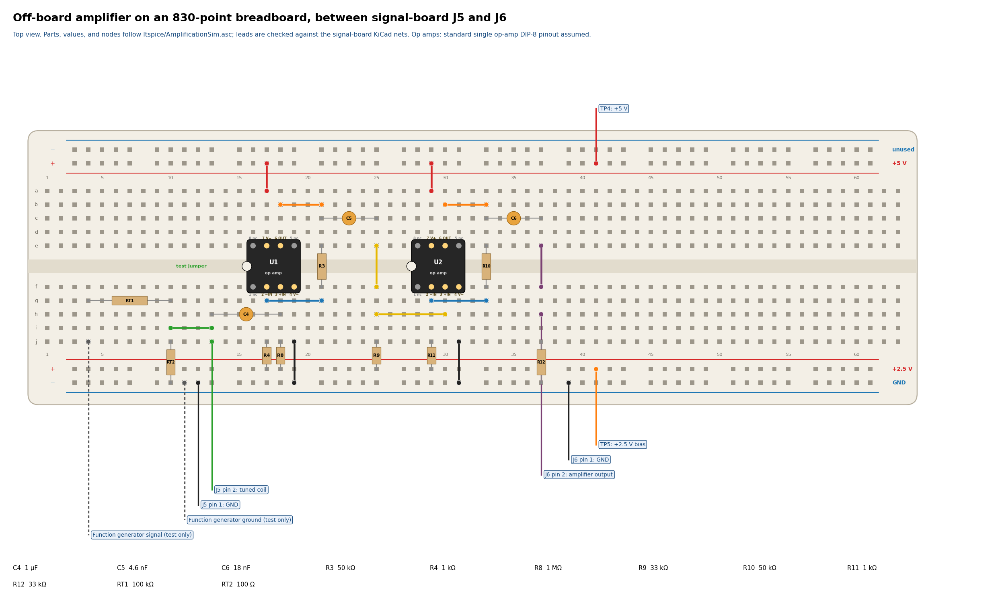

# Off-board amplifier breadboard

Generated by `python3 -m util.breadboard` (`make breadboard`). Do not edit by hand.

The signal board has no amplifier: J5 brings out the tuned coil and J6 takes the amplified signal back to the ADC path. This layout builds the two stages from [`ltspice/AmplificationSim.asc`](../../ltspice/AmplificationSim.asc) on a standard 830-point breadboard. References are the LTspice ones, so this R8 (1 MΩ) is not the signal board's R8 (10 kΩ). Before drawing, the generator checks every hole against the LTspice netlist and every lead against the signal-board schematic.

Rows a–e are above the centre channel and f–j below it. Rails: `T+` +5 V, `B+` +2.5 V, `B-` GND, `T-` unused. Check that each rail is continuous from column 10 to column 41; some boards split their rails at the middle.

## Op amps

The design files do not name the op amp. The LTspice model is a generic UniversalOpAmp2 (Avol 316k, GBW 3 MHz, slew 2.4 V/µs, 2.7 nV/√Hz, 5 V single supply, outputs within 0.1 V of the rails). The layout assumes two single op amps in the standard DIP-8 pinout, notch toward column 1: pin 2 −IN, 3 +IN, 4 V−, 6 OUT, 7 V+, and pins 1, 5, 8 unconnected. Check the chosen part's pinout first.

Op amp | Pin holes (1–4, then 5–8)
--- | ---
U1 | f16, f17, f18, f19, e19, e18, e17, e16
U2 | f28, f29, f30, f31, e31, e30, e29, e28

## Parts

Ref | Value | Holes | Note
--- | --- | --- | ---
C4 | 1 µF | h18, h13 |
R8 | 1 MΩ | j18, B+18 |
R4 | 1 kΩ | B+17, j17 |
R3 | 50 kΩ | f21, e21 | not an E24 value; nearest 51 kΩ
C5 | 4.6 nF | c25, c21 | not an E12 value; nearest 4.7 nF
R9 | 33 kΩ | j25, B+25 |
R11 | 1 kΩ | B+29, j29 |
R10 | 50 kΩ | f33, e33 | not an E24 value; nearest 51 kΩ
C6 | 18 nF | c37, c33 |
R12 | 33 kΩ | j37, B-37 |

## Jumpers

From | To
--- | ---
a17 | T+17
j19 | B-19
g17 | g21
b18 | b21
f25 | e25
h25 | h30
a29 | T+29
j31 | B-31
g29 | g33
b30 | b33
f37 | e37

## Leads

Hole | Connects to
--- | ---
j13 | J5 pin 2: tuned coil
B-12 | J5 pin 1: GND
h37 | J6 pin 2: amplifier output
B-39 | J6 pin 1: GND
T+41 | TP4: +5 V
B+41 | TP5: +2.5 V bias

The +5 V and +2.5 V leads come from signal-board test points TP4 (5VRail) and TP5 (the OPA320-buffered 2.5VBias). In the LTspice drawing these are 5P and 25P, and the same 2.5 V also biases the ADC input, as on the board. V5, the drawing's separate 2.5 V source for R9, is the same rail here. Ground returns through J5 pin 1 and J6 pin 1. Use twisted pairs for the J5 and J6 leads.

## Function-generator test

The drawing suggests starting without the coil, with ±180 µV at the amplifier input. RT1 (100 kΩ) and RT2 (100 Ω) divide a High-Z generator by about 1001, so set it to about 180 mV peak. Measure RT1 and RT2 for the exact ratio.

Ref | Value | Holes
--- | --- | ---
RT1 | 100 kΩ | g4, g10
RT2 | 100 Ω | j10, B-10

Generator signal → j4, ground → B-11. The green jumper i10–i13 joins the divider to the amplifier input. Remove the jumper and the generator before connecting J5 and the coil; RT1 and RT2 can stay.
