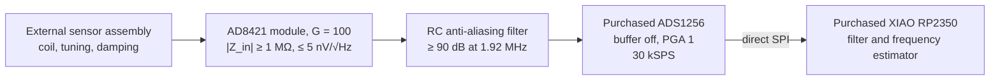
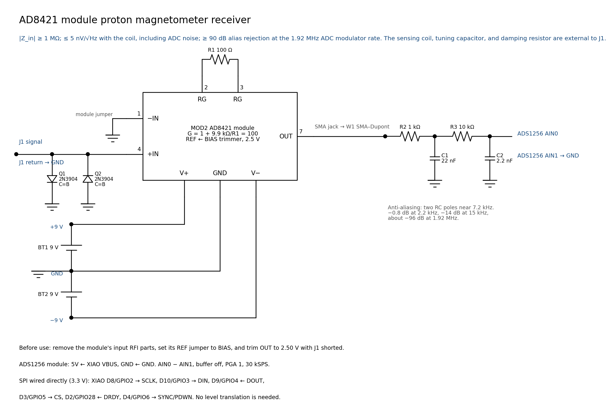

# Receiver

- The receiver starts at J1; coil tuning and damping remain external.
- Amazon parts ($48.95, `amazon_purchases.json`): AD8421 module, SMA cable, two 9 V batteries and clips.
- Seven lab parts: two transistor clamps, the 100 Ω gain resistor, and two RC sections.
- `make verify` fails if input impedance, noise, interference, or alias-rejection requirements are missed at any of ten corners.

---

# Signal chain

- AD8421 module, G = 100, powered from ±9 V batteries; BIAS trimmer sets OUT to 2.5 V
- The module's input RFI parts are removed so they cannot load the coil
- R2/C1 (1 kΩ, 22 nF) and R3/C2 (10 kΩ, 2.2 nF): −0.8 dB at 2.2 kHz, −14 dB at 15 kHz, about −96 dB at 1.92 MHz
- The firmware band-pass does the narrow filtering; the analog low-pass stops modulator-rate aliases that the ADS1256's digital filter cannot reject
- No level translators: the XIAO drives the ADS1256 SPI directly

---

# Sensitivity and blanking

- Simulated input noise: 3.9 nV/√Hz with the untuned coil (ADC included), 23.4 nV/√Hz with a 30 kΩ source
- Frequency CRB with the untuned coil: 0.02 nT for the 3.59 µV FID, 0.19 nT for 0.41 µV; target 1 nT
- XIAO discards the blank, then briefly pulses SYNC/PDWN to restart the digital filter
- The AD8421's overload recovery after the polarizer pulse must be measured; the model does not clip

---

# Simulated analog transfer

- Example 10 µV source through provisional 30 kΩ external source impedance
- 83–87 V/V across 1.6–2.2 kHz; −3 dB at 4.6 kHz; |Z_in| 4.25–7.08 MΩ
- The model excludes ADC noise, digital filtering, and external coil resonance

---

# Frequency estimator

- One record of up to 1.5 s at 30 kSPS
- The estimator core exists; ADS1256 SPI acquisition and USB reporting remain to be written
- The 1 nT repeatability target is not established for this lower-sensitivity analog path
