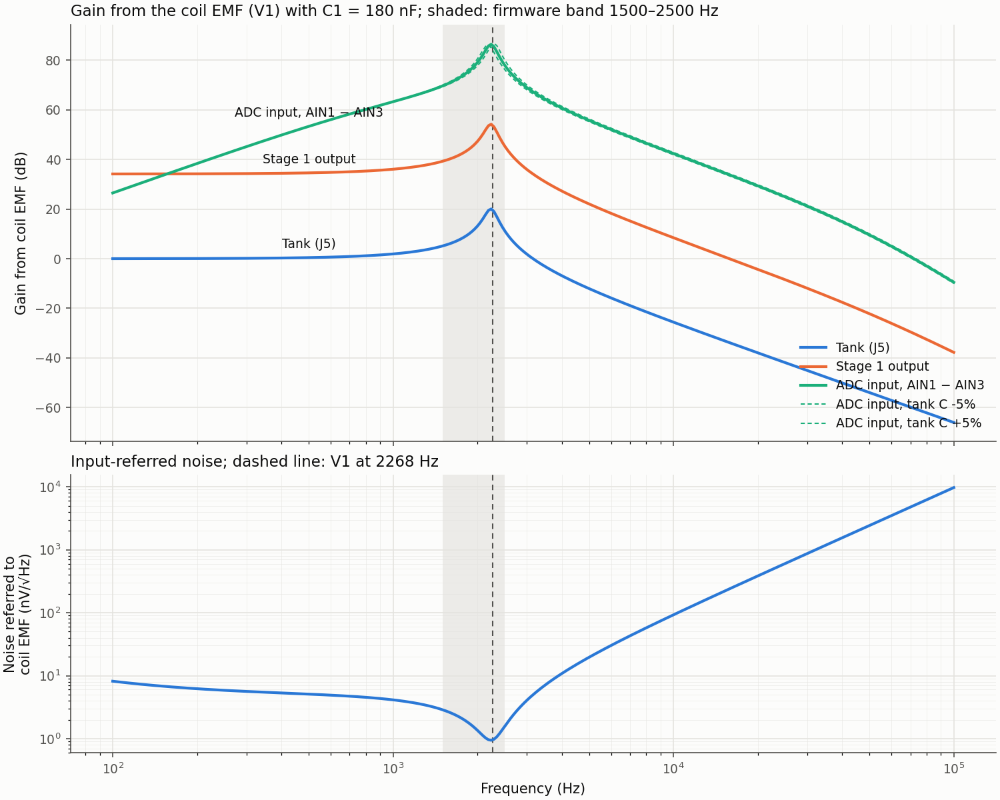
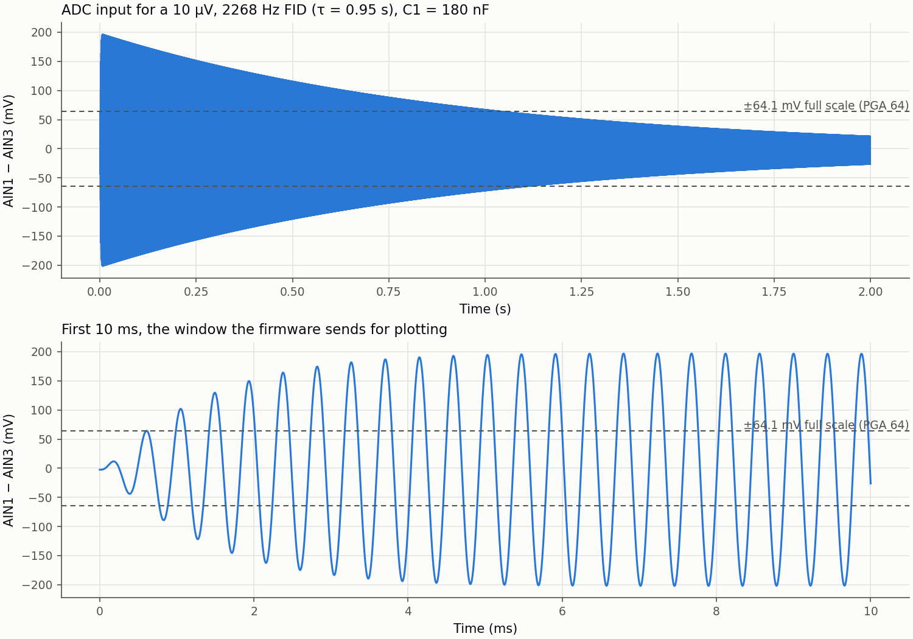

# Amplifier simulation

Generated by `python3 -m util.simulate` (`make sim`) from [`ltspice/AmplificationSim.asc`](../../ltspice/AmplificationSim.asc) with ngspice. Do not edit by hand. Values are simulated, not measured.

`util/ltspice.py` reads the drawing's wires, flags, and symbols and writes [`amplifier.cir`](amplifier.cir). Its `universalopamp2` subcircuit reproduces LTspice's UniversalOpAmp2 (level 2) model; on 2026-10-28 it matched LTspice 17.2.4 to within 0.001 dB in gain from 1 to 5 kHz (0.03 dB at 20 kHz) and 0.01% in noise for this circuit (`util/tests/test_ltspice.py`). The output current limit (Ilimit) is not modeled.

## Circuit as drawn

- Coil: V1 `SINE(0 10uV 2268 0 1.0526 0)` in series with 39 Ω and 28.11 mH. The FID is 10 µV peak at 2268 Hz (53.27 µT), decaying with τ = 0.95 s.
- Tank: C1 = `{Cnom*(1+tol)}`, 180 nF nominally, with tol stepped through -0.05, +0, +0.05. The drawing notes that 175.2 nF would resonate exactly at the source frequency.
- Two non-inverting stages, each 1 + 50 kΩ / 1 kΩ = 51, biased at 2.5 V and AC coupled (C5 4.6 nF / R9 33 kΩ, then C6 18 nF / R12 33 kΩ). R14/C8, R15/C9, R1/C3, and R13/C7 model op-amp and ADS1256 input impedance rather than parts.
- V6 is drawn but not connected, so it is not simulated.

## Operating point

Node | DC level
--- | ---
Stage 1 output (`VopAmpOut1`) | 2.5255 V
Stage 2 output (`c6_2`) | 2.5255 V
J6 (`VopAmpOut2`, after C6/R12) | 0.0000 V
ADC signal input (`AIN1`) | 2.4975 V
ADC reference input (`n25P`, AIN3 in the drawing) | 2.5000 V

## Gain from the coil EMF

Node | 1500 Hz | 2000 Hz | 2268 Hz | 2500 Hz
--- | --- | --- | --- | ---
Tank (J5) | 1.8 (5.1 dB) | 4.6 (13.2 dB) | 9.6 (19.6 dB) | 3.7 (11.3 dB)
Stage 1 output | 91.9 (39.3 dB) | 232.0 (47.3 dB) | 489.4 (53.8 dB) | 187.3 (45.5 dB)
Stage 2 output | 3,840.4 (71.7 dB) | 10,471.5 (80.4 dB) | 22,633.9 (87.1 dB) | 8,800.9 (78.9 dB)
ADC input, AIN1 − AIN3 | 3,030.6 (69.6 dB) | 9,040.1 (79.1 dB) | 20,114.1 (86.1 dB) | 7,969.5 (78.0 dB)
ADC input, tank C -5% | 2,915.3 (69.3 dB) | 7,780.1 (77.8 dB) | 21,286.5 (86.6 dB) | 10,143.3 (80.1 dB)
ADC input, tank C +5% | 3,155.1 (70.0 dB) | 10,677.5 (80.6 dB) | 15,908.4 (84.0 dB) | 6,531.3 (76.3 dB)

## FID amplitude

[`spreadsheets/CoilDesign.xlsx`](../../spreadsheets/CoilDesign.xlsx) plans the coils, and the print files in [`3d_models/`](../../3d_models/) give their forms (`util/printfile.py` measures them from the G-code):

- Sensing form: 60 × 60 mm core, 56 × 56 mm opening for the water, 100 mm winding length, 70 × 70 mm flanges, 106 mm tall. Planned winding: 1477 turns of 0.462 mm wire.
- Polarizing form: 76 × 146.4 mm core, 71 × 140.7 mm opening, 100 mm winding length. Planned winding: 331 turns, 3 A, 8.63 mT at the center, 9.84 mH, 7.91 Ω.
- Two sensing forms fit side by side in the polarizing form's opening, with their windings over the same 100 mm, so the forms appear made to nest, the sensing coils sharing the polarizing coil's axis.

Curie-law FID for the two sensing coils in series, each around water that fills its opening, fully polarized at 8.63 mT, with the polarizing axis perpendicular to Earth's field, at 2268 Hz and 20 °C. "At the ADC" applies the simulated gain at that frequency (20,114 V/V); the last column is the open-circuit voltage the polarizer's turn-off induces in the pair (below).

Sensing coil | Turns per coil | L per coil | R per coil | FID at the pair | At the ADC | Peak / wideband noise | Turn-off pickup
--- | --- | --- | --- | --- | --- | --- | ---
planned (CoilDesign.xlsx) | 1477 | 76.3 mH | 50.0 Ω | 4.71 µV | 95 mV | 98 | 317 V
from the measured inductance (TuningCapacitors.xlsx) | 628 | 13.3 mH | 20.6 Ω | 2.00 µV | 40 mV | 42 | 127 V
from the coil resistance (AmplificationSim.asc) | 594 | 11.9 mH | 19.5 Ω | 1.89 µV | 38 mV | 40 | 120 V

The measured inductances (13.45 and 13.13 mH) and the drawing's 39 Ω coil resistance both imply about 594–628 turns per coil, not 1477. The drawing's 10 µV is 2.1 times the planned estimate and 5.0 times the as-built one; the workbook's 72 µV "illustrative series-pair peak" is scaled from an assumed baseline, not a physical prediction. Each assumption above is a best case: a partly filled opening, incomplete polarization (water's T1 is about 2–3 s), a polarizing axis not perpendicular to Earth's field, and the coils' finite length all lower the FID.

Turn-off pickup: when the polarizer's current falls into its TVS (the workbook assumes 68 V), it starts falling at 9,325 A/s and reaches zero in about 0.37 ms. For nested coils the induced EMF is about turns × field per amp × mean turn area × that rate, using the polarizer's center field. The sensing coils sit off center, where the field is weaker, so the real voltage is lower but of the same order. The sensing circuit, the damping switch, and the amplifier input must survive it.

## ADC headroom

The firmware sets PGA 64 with VREF = 2.05 V, a differential full scale of ±64.1 mV. The drawing's FID reaches 202.0 mV peak at the ADC in its first 100 ms, 3.2 times full scale. It would clip. PGA 16 or lower keeps it within full scale. The Curie-law estimates above reach 95 mV (planned, clips), 40 mV (from the measured inductance, fits), 38 mV (from the coil resistance, fits). The ADS1256 input buffer is on (BUFEN = 1), so each input must also stay within 0 to AVDD − 2 V. The firmware measures AIN1 − AIN0, while the drawing biases AIN3; confirm which ADS1256 inputs the J4 socket reaches.

The transient runs to 2 s as the drawing's `.tran` does, but with a 4.4 µs step. At the drawing's 34 µs maximum step, about 13 points per cycle, trapezoidal integration detunes the tank and the same FID peaks at 176.1 mV, 13% low. Use a maximum step near 4 µs in LTspice too.

## Noise

- Referred to the coil EMF at 2268 Hz: 0.96 nV/√Hz. At the ADC input: 18.97 µV/√Hz.
- ADC-input RMS noise over 1500–2500 Hz: 421 µV; over 100 Hz to 7500 Hz (Nyquist at the firmware's nominal 15 kSPS): 964 µV. The zero-crossing estimator does not filter, so the wider figure applies to it. Noise above Nyquist also aliases into the record; the ADS1256's digital filter is not modeled.
- Peak FID to wideband RMS noise at the ADC: 210 for the drawing's FID; the FID amplitude table gives it for the Curie-law estimates.
- Frequency Cramér–Rao bound: 0.0012 nT, for a white floor at the EMF-referred density, 15 kSPS, and a 2.19 s record (the firmware stops when the signal falls to 10% of its initial amplitude, at most 4 s). It bounds an ideal estimator, not the zero-crossing fit.

## Tuning bank

The signal board switches 11 capacitors across the coil with SW1 and SW2: C1 0.47 nF (SW2-8), C2 1 nF (SW2-7), C3 2.2 nF (SW2-6), C4 3.3 nF (SW2-5), C5 4.7 nF (SW2-4), C6 10 nF (SW2-3), C7 22 nF (SW2-2), C8 47 nF (SW2-1), C9 82 nF (SW1-3), C10 100 nF (SW1-2), C11 150 nF (SW1-1), 422.67 nF in total. TuningCapacitors.xlsx uses a 392.67 nF bank total in its reference row, which does not match the schematic. The workbook's coils are 13.45 mH and 13.13 mH in series (26.58 mH, mutual inductance neglected); the LTspice coil is 28.11 mH. With every switch on, the tank resonates at 1502 Hz (TuningCapacitors.xlsx) and 1460 Hz (AmplificationSim.asc). With 39 Ω of coil resistance the tank's Q is about 10, so its bandwidth near 2268 Hz is about 224 Hz, far wider than the 0.47 nF step.

Switch settings closest to each target (`SW2-1` is switch 1 of SW2):

Target | Field | Coil | Needed | Bank | Tuned | Capacitors on | Switches on
--- | --- | --- | --- | --- | --- | --- | ---
1500 Hz | 35.23 µT | TuningCapacitors.xlsx (26.58 mH) | 423.55 nF | 422.67 nF | 1501.6 Hz | C11 C10 C9 C8 C7 C6 C5 C4 C3 C2 C1 | SW1-1 SW1-2 SW1-3 SW2-1 SW2-2 SW2-3 SW2-4 SW2-5 SW2-6 SW2-7 SW2-8
1500 Hz | 35.23 µT | AmplificationSim.asc (28.11 mH) | 400.49 nF | 400.67 nF | 1499.7 Hz | C11 C10 C9 C8 C6 C5 C4 C3 C2 C1 | SW1-1 SW1-2 SW1-3 SW2-1 SW2-3 SW2-4 SW2-5 SW2-6 SW2-7 SW2-8
1750 Hz | 41.10 µT | TuningCapacitors.xlsx (26.58 mH) | 311.18 nF | 311.20 nF | 1749.9 Hz | C11 C9 C8 C7 C5 C4 C3 | SW1-1 SW1-3 SW2-1 SW2-2 SW2-4 SW2-5 SW2-6
1750 Hz | 41.10 µT | AmplificationSim.asc (28.11 mH) | 294.24 nF | 294.17 nF | 1750.2 Hz | C11 C9 C8 C6 C5 C1 | SW1-1 SW1-3 SW2-1 SW2-3 SW2-4 SW2-8
2000 Hz | 46.97 µT | TuningCapacitors.xlsx (26.58 mH) | 238.25 nF | 238.17 nF | 2000.3 Hz | C11 C9 C5 C2 C1 | SW1-1 SW1-3 SW2-4 SW2-7 SW2-8
2000 Hz | 46.97 µT | AmplificationSim.asc (28.11 mH) | 225.28 nF | 225.20 nF | 2000.3 Hz | C10 C9 C7 C6 C5 C4 C3 C2 | SW1-2 SW1-3 SW2-2 SW2-3 SW2-4 SW2-5 SW2-6 SW2-7
2250 Hz | 52.85 µT | TuningCapacitors.xlsx (26.58 mH) | 188.24 nF | 188.17 nF | 2250.4 Hz | C10 C9 C5 C2 C1 | SW1-2 SW1-3 SW2-4 SW2-7 SW2-8
2250 Hz | 52.85 µT | AmplificationSim.asc (28.11 mH) | 178.00 nF | 178.00 nF | 2250.0 Hz | C10 C8 C7 C5 C4 C2 | SW1-2 SW2-1 SW2-2 SW2-4 SW2-5 SW2-7
2268 Hz | 53.27 µT | TuningCapacitors.xlsx (26.58 mH) | 185.27 nF | 185.30 nF | 2267.8 Hz | C10 C9 C4 | SW1-2 SW1-3 SW2-5
2268 Hz | 53.27 µT | AmplificationSim.asc (28.11 mH) | 175.18 nF | 175.17 nF | 2268.1 Hz | C10 C8 C7 C5 C2 C1 | SW1-2 SW2-1 SW2-2 SW2-4 SW2-7 SW2-8
2500 Hz | 58.72 µT | TuningCapacitors.xlsx (26.58 mH) | 152.48 nF | 152.47 nF | 2500.1 Hz | C9 C8 C7 C2 C1 | SW1-3 SW2-1 SW2-2 SW2-7 SW2-8
2500 Hz | 58.72 µT | AmplificationSim.asc (28.11 mH) | 144.18 nF | 144.17 nF | 2500.1 Hz | C9 C8 C6 C5 C1 | SW1-3 SW2-1 SW2-3 SW2-4 SW2-8

Fields use the shielded-proton ratio, 0.0425764 Hz/nT. The firmware and the workbook use the free-proton ratio, 25.7 ppm higher (`util/physics.py`).

Files: [`frequency-response.csv`](frequency-response.csv), [`noise.csv`](noise.csv), [`transient-first-10ms.csv`](transient-first-10ms.csv), [`tuning-bank.csv`](tuning-bank.csv).
