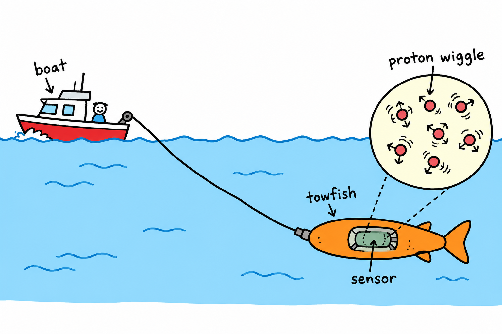
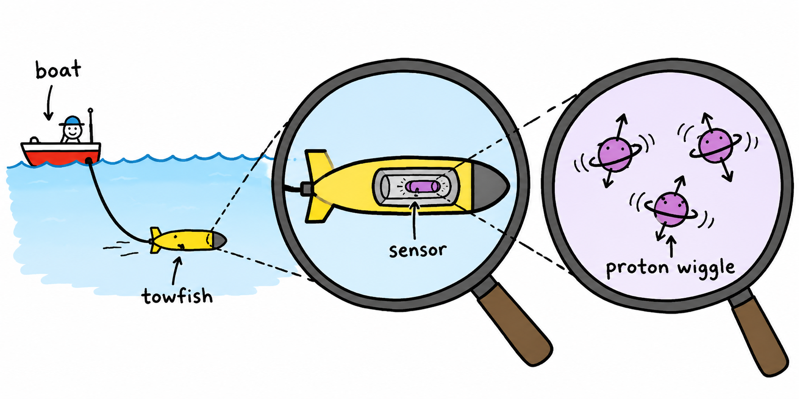
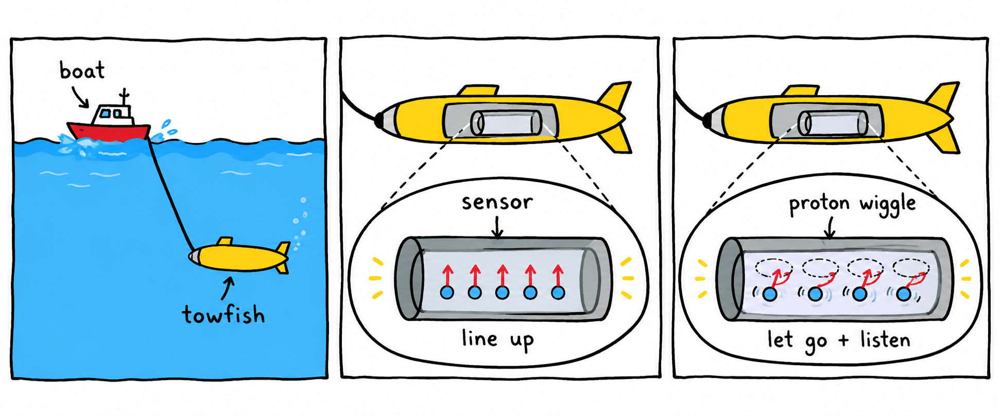
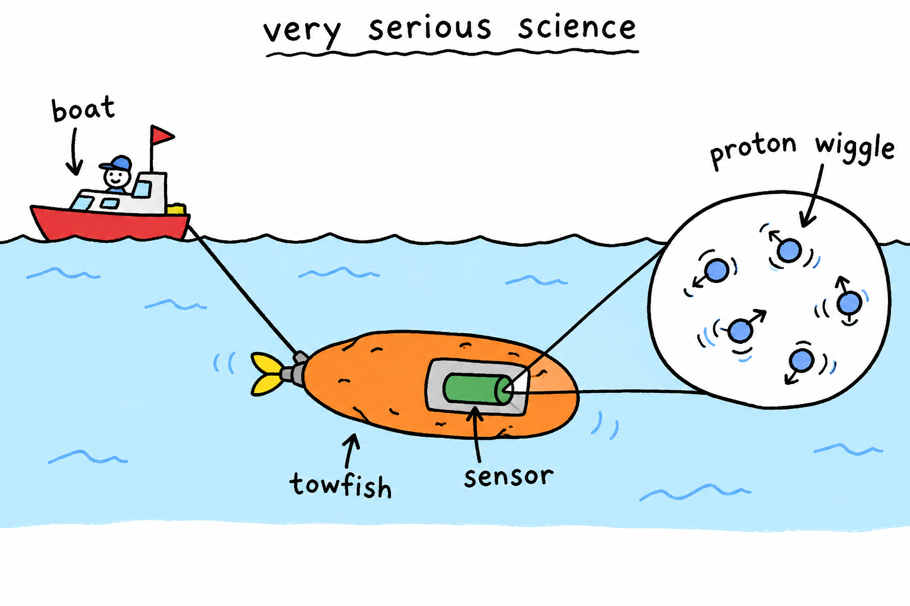
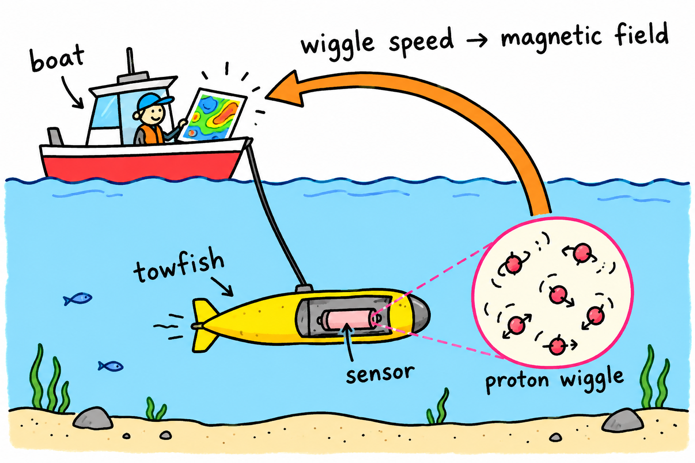

# boat, towfish, sensor, proton wiggle

Five silly MS Paint–style options for how our proton magnetometer should work.

The boat tows the towfish. The sensor lives inside the towfish. We briefly line up the protons, let go, and listen to their wiggle. How fast they wiggle tells us the magnetic field.

## 1. The classic boat situation

Boat up here. Towfish down there. Tiny proton party inside.

## 2. Enhance. ENHANCE.

Zoom into the towfish, then into the sensor, then into the wiggle.

## 3. The wiggle trilogy

Tow it. Line the protons up. Let go and listen.

## 4. Very serious science potato

The towfish has achieved potato form. Science continues.

## 5. Follow the wiggle

Tiny wiggles underwater become magnetic-field measurements on the boat.

---

Generated with the built-in image generation tool. The five complete prompts are saved in [generation-prompts.json](generation-prompts.json). These are concept cartoons; shapes and sizes are illustrative.
