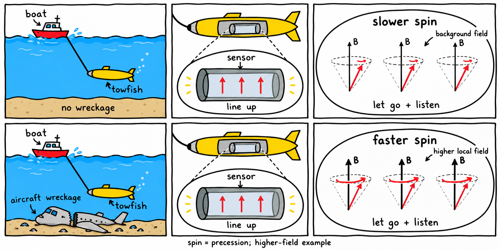

# The spin trilogy

Two rows, three panels each: tow the sensor, line up the proton spins, then release and listen to their precession.

The first row shows the background field without wreckage and **slower spin**. The second shows aircraft wreckage with a higher local magnetic field and **faster spin**.

Here, “spin” means **spin precession**: the magnetic-moment arrows turn around the local field axis, like a top precessing. The measured precession rate increases with field strength. See the [Geometrics proton magnetometer manual](https://www.geometrics.com/wp-content/uploads/2018/10/877Manual.pdf).

The wreckage row illustrates a higher-field location. Actual wreckage can produce increases or decreases depending on position and magnetization; see the [magnetometer applications manual](https://geometrics.com/wp-content/uploads/2018/10/m-ampm-05Apr06.pdf). The speed difference is exaggerated for illustration.

Made with the built-in image generation tool; the complete edit prompt is in [generation-prompt.txt](generation-prompt.txt).
