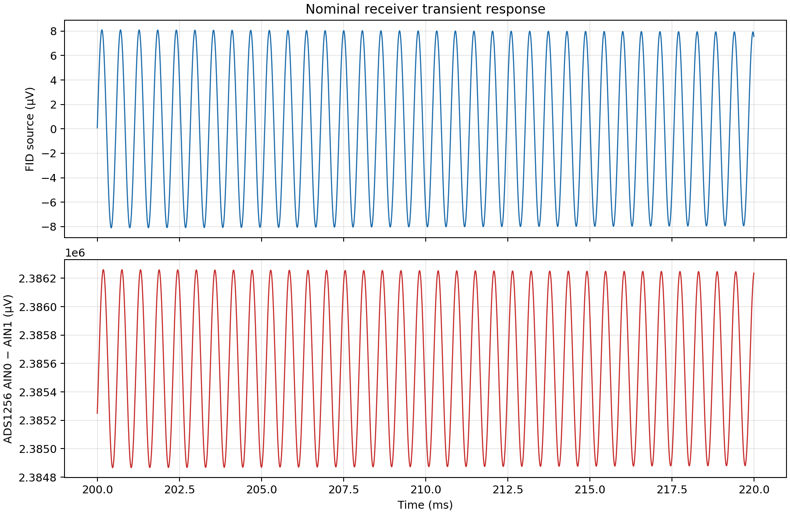
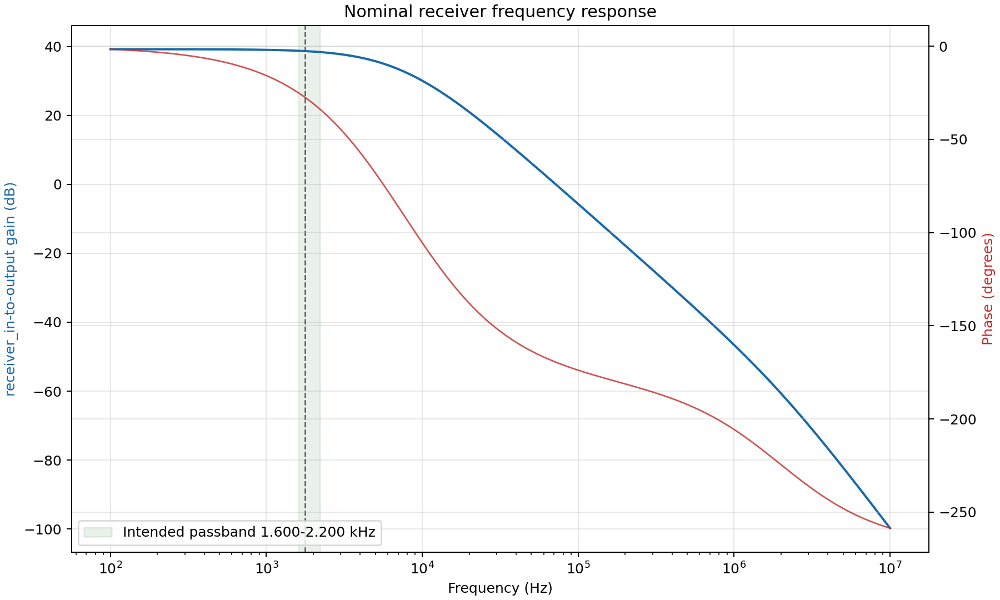

# Generated receiver analysis

Generated by `python3 receiver_design/analyze.py` using ngspice and Matplotlib. Values are simulated, not measured.

- Analysis netlist: `spice/receiver.cir`
- Nominal frequency marker: 1765.000 Hz
- Gain near nominal frequency: 38.70 dB (86.1 V/V)
- Specified band: 1600 to 2200 Hz
- Simulated peak gain: 91.5 V/V at 100 Hz
- Simulated low-pass -3 dB corner: 4571 Hz
- Simulated in-band gain range: 83.4 to 87.0 V/V
- Settled J1 input peak: 8.016 µV
- Settled ADC differential peak about its mean: 695.8 µV
- Simulated |Z_in| at J1 over 1500–2500 Hz: 4.25 to 7.08 MΩ
- Largest tone at J1 without clipping, 50–400 Hz: 27.2 mV peak (limited by `ain0`; requirement 10 mV)
- Largest tone at J1 without clipping, 8000–50000 Hz: 49.0 mV peak (limited by `amp_out`; requirement 2 mV)
- Alias rejection within 2.2 kHz of the 1.92 MHz modulator rate: 98.2 dB (requirement 90 dB)

Gain is from J1 (`receiver_in`) through the AD8421 module (G = 100) and the two-section RC anti-aliasing filter to ADS1256 AIN0, with AIN1 at GND. The 11 kΩ filter resistance and the ADS1256's unbuffered input impedance lower the in-band gain to about 85 V/V. `make verify` checks |Z_in|, noise, interference, and alias rejection at temperature, supply, battery, trim, and tolerance corners. The test source is 10 µV behind a 30 kΩ fixture that stands in for the externally tuned sensor. Coil tuning and damping are outside this receiver model.

## Noise

Input-referred to the source EMF, integrated from 1.6 to 2.2 kHz with ngspice `.noise`, plus the ADS1256's 10.3 µV RMS converter noise (PGA 1, 30 kSPS, buffer off) referred through the minimum in-band gain, 1.01 nV/√Hz. The noise figure compares the in-band total with the source resistance's thermal noise alone. The frequency CRB uses the untuned coil's EMF-referred density at 1876 Hz as a white floor, a 1.5 s record at 30 kSPS after a 200 ms blank, and T2* = 0.95 s. Compare it with the 1 nT target. An external tuned capacitor raises the FID and coil noise together, which lowers the receiver's share of the noise. The AD8421 model uses the datasheet's maximum 3.2 nV/√Hz input voltage noise and typical 60 nV/√Hz output and 200 fA/√Hz current noise. It omits the module's BIAS/REF path noise, so measure the floor on the bench.

| Source at J1 | Input noise at 1876 Hz | 1600–2200 Hz input RMS | Noise figure | AIN0 RMS | Frequency CRB |
|---|---:|---:|---:|---:|---|
| 30 kΩ tuned-sensor fixture | 23.38 nV/√Hz | 573 nV | 0.4 dB | 49 µV | — |
| Untuned coil pair (99.9 Ω, 152.6 mH) | 3.88 nV/√Hz | 95 nV | 9.6 dB | 8 µV | 0.021 nT (3.59 µV active coil), 0.188 nT (0.41 µV pessimistic) |
| Shorted input (amplifier only) | 3.64 nV/√Hz | 89 nV | — | 7 µV | — |
